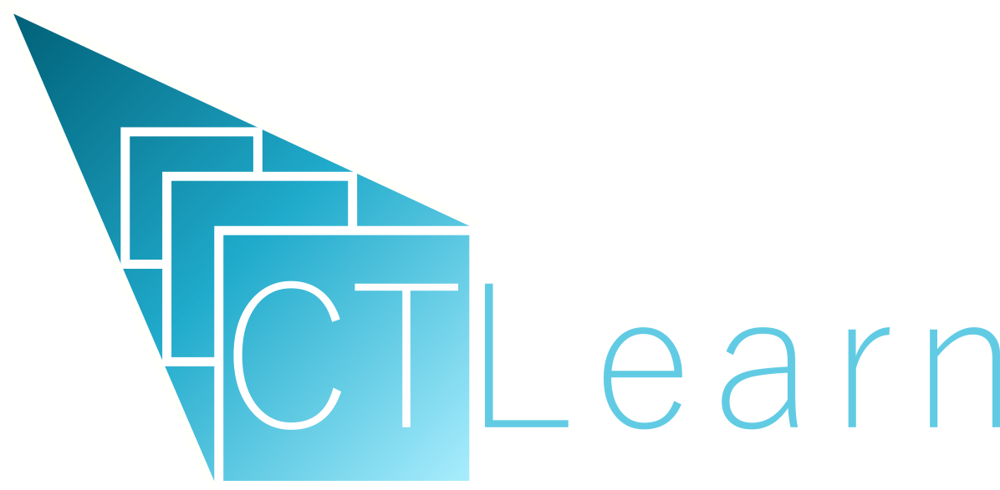

.. CTLearn documentation master file, created by
   sphinx-quickstart on Mon Mar 28 13:43:00 2022.
   You can adapt this file completely to your liking, but it should at least
   contain the root `toctree` directive.

CTLearn: Deep Learning for IACT Event Reconstruction
====================================================

.. CAUTION:: This is not production-ready code yet. Although stable
   releases are available, users should expect changes to the code
   before a 1.0 release arrives.

* Code, feature requests, bug reports, pull requests: https://github.com/ctlearn-project/ctlearn
* Documentation: https://ctlearn-project.github.io/ctlearn/
* License: BSD-3

Use the version selector in the sidebar to switch between the current
``main`` documentation and published tagged releases.

.. grid:: 1 2 3 3
   :gutter: 3

   .. grid-item-card:: User Guide
      :link: userguide
      :link-type: doc

      Explore the public CTAO data tutorials, train CTLearn models, and run
      inference on image and waveform data.

   .. grid-item-card:: Developer Guide
      :link: devguide
      :link-type: doc

      Set up a development environment and contribute to CTLearn.

   .. grid-item-card:: API Docs
      :link: api
      :link-type: doc

      Browse the CTLearn Python package and its modules.

.. toctree::
   :maxdepth: 2
   :caption: Contents:

   devguide
   usage
   userguide
   supplementary
   api
   changelog

Documentation
==================

* :ref:`genindex`
* :ref:`modindex`
* :ref:`search`
