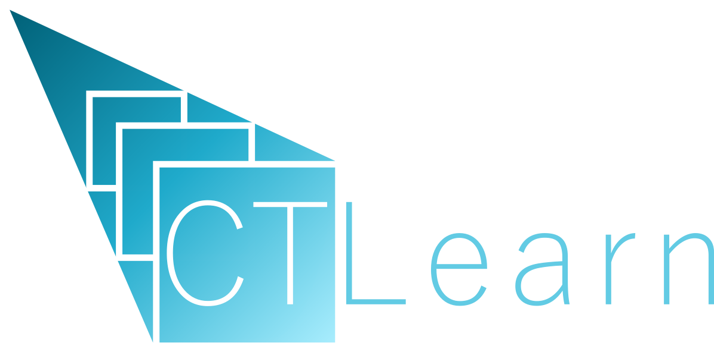

.. title:: Home

:html_theme.sidebar_secondary.remove: true
:html_theme.sidebar_primary.remove: true

.. _ctlearn:

**Version**: |version| **Date**: |today|

.. toctree::
   :maxdepth: 1
   :hidden:

   user-guide/index
   developer-guide/index
   workflows/index
   api-reference/index
   changelog

.. grid:: 1 2 2 2
   :gutter: 4

   .. grid-item-card:: User Guide
      :link: user-guide/index
      :link-type: doc

      Install the latest CTLearn version, learn the basics, and explore tutorials.

   .. grid-item-card:: Developer Guide
      :link: developer-guide/index
      :link-type: doc

      Set up a development environment and contribute to CTLearn.

   .. grid-item-card:: CWL workflows
      :link: workflows/index
      :link-type: doc

      Learn how to use the CTLearn CWL workflows.

   .. grid-item-card:: API Docs
      :link: api-reference/index
      :link-type: doc

      Browse the CTLearn Python package and its modules.
